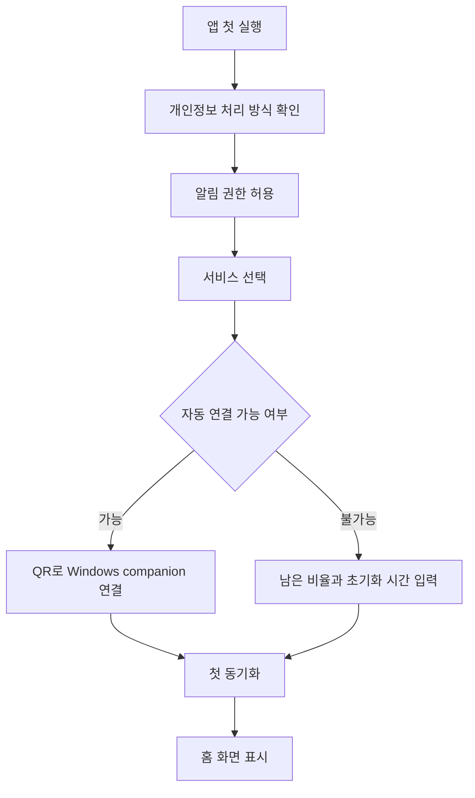
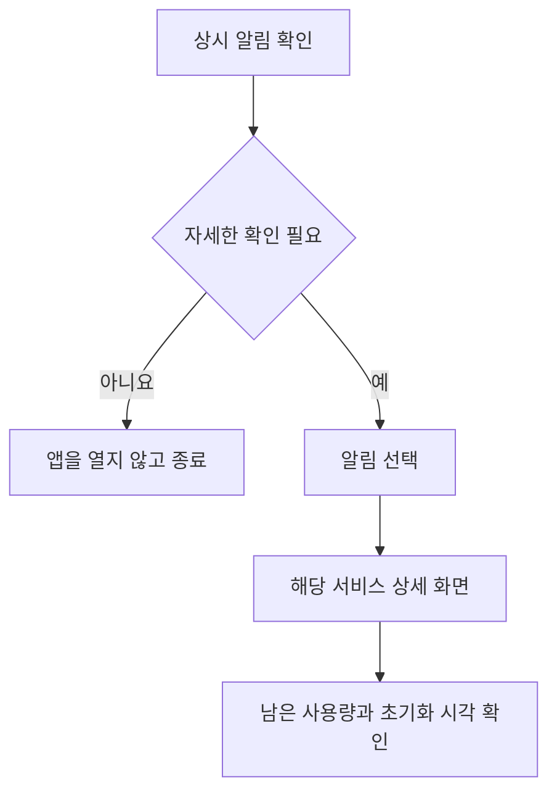
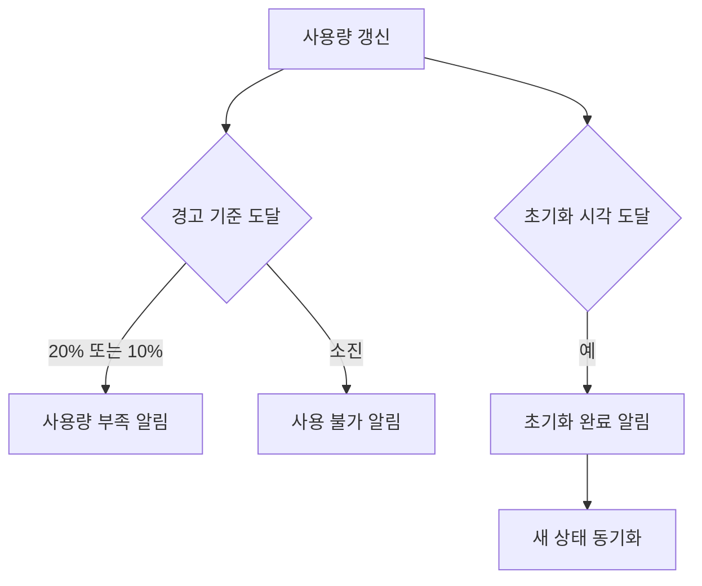

# TokenPilot 제품 기획서

- 문서 버전: 0.1
- 작성일: 2026-09-20
- 상태: 초기 기획
- 대상 플랫폼: Android

## 1. 제품 개요

TokenPilot은 Codex, Claude, Gemini, Grok 같은 월정액 AI 서비스의 남은 사용량과 초기화 시간을 한곳에서 확인하는 Android 앱이다. 사용자는 앱을 열지 않아도 Android 알림창에서 현재 상태와 가장 가까운 초기화 시간을 확인할 수 있다.

TokenPilot의 핵심 가치는 다음과 같다.

1. 여러 AI 서비스의 사용량을 한 화면에서 확인한다.
2. 5시간, 일간, 주간 등 서로 다른 초기화 시간을 이해하기 쉽게 표시한다.
3. 사용량 부족과 초기화 완료를 적절한 시점에 알린다.
4. 공식 데이터와 추정 또는 수동 입력 데이터를 명확히 구분한다.

## 2. 확정된 제품 방향

### 2.1 관리 대상

개발자 API 사용량이 아니라 ChatGPT/Codex, Claude, Gemini, Grok의 월정액 구독 사용량을 관리한다.

### 2.2 표시 단위

서비스마다 사용 제한을 계산하는 방식이 다르므로 모든 서비스를 임의의 토큰 수로 변환하지 않는다. 서비스가 제공하는 실제 단위에 따라 다음 정보를 표시한다.

- 남은 사용량 비율
- 사용 가능 여부
- 적용 중인 제한 구간
- 다음 초기화 시각
- 초기화까지 남은 시간
- 마지막 동기화 시각
- 데이터 출처와 신뢰 상태

### 2.3 데이터 신뢰 상태

모든 사용량 값에는 다음 중 하나를 표시한다.

- `실시간`: 공식 연동으로 방금 확인한 값
- `PC 동기화`: 사용자의 PC에서 확인해 전달한 값
- `수동 입력`: 사용자가 직접 입력한 값
- `오래된 정보`: 정해진 시간 동안 갱신되지 않은 값
- `연결 필요`: 아직 데이터를 받을 수 없는 상태

정확한 데이터를 얻을 수 없을 때 추정값을 실제 잔여량처럼 표시하지 않는다.

## 3. 목표 사용자

### 주요 사용자

- 여러 월정액 AI 서비스를 번갈아 사용하는 개인 사용자
- Codex나 Claude Code를 장시간 사용하는 개발자
- 서비스별 초기화 시간을 자주 확인하는 사용자

### 해결하려는 문제

- 각 서비스의 사용량 화면을 매번 따로 열어야 한다.
- 5시간 한도와 주간 한도의 초기화 시간을 기억하기 어렵다.
- 작업 도중 사용량이 갑자기 소진된다.
- 서비스마다 제한 단위와 표시 방식이 달라 비교하기 어렵다.

## 4. MVP 범위

### 포함

- Codex와 Claude 사용량 카드
- Gemini와 Grok 수동 추적
- 5시간, 세션, 일간, 주간 제한 표시
- 다음 초기화까지 남은 시간
- Android 상시 알림
- 초기화 사전 알림과 완료 알림
- 사용량 20%, 10%, 소진 알림
- 마지막 동기화 시각
- 데이터 신뢰 상태 표시
- Windows companion 연결 구조
- 오프라인에서도 마지막 데이터 표시

### 제외

- API 사용 비용 및 개발자 API 토큰 관리
- 로그인 쿠키, 비밀번호 수집
- 비공개 API 호출과 웹 화면 무단 스크래핑
- iOS 앱
- 팀 및 조직 관리
- 자체 클라우드 계정 시스템
- 자동 결제 또는 구독 구매

## 5. 정보 구조

하단 내비게이션은 세 개로 제한한다.

1. `홈`: 서비스별 남은 사용량과 가장 가까운 초기화
2. `초기화`: 시간순 초기화 일정과 알림 규칙
3. `설정`: 알림, 서비스 연결, Windows 연결, 보안 상태

서비스 카드를 누르면 해당 서비스의 상세 화면으로 이동한다.

## 6. 화면 구성

### 6.1 첫 실행 화면

목적은 기능 소개보다 빠른 설정 완료다.

- TokenPilot이 저장하는 정보 설명
- 로그인 쿠키와 비밀번호를 저장하지 않는다는 안내
- 알림 권한 요청
- 연결할 서비스 선택
- Windows companion 연결 또는 수동 입력 선택

### 6.2 홈 화면

상단에는 가장 가까운 초기화를 크게 표시한다.

예시:

```text
가장 가까운 초기화
1시간 48분
Codex 5시간 한도 · 오후 11:29 초기화
```

서비스 카드는 다음 정보를 포함한다.

- 서비스 이름
- 제한 종류
- 남은 사용량 비율
- 진행 막대
- 초기화까지 남은 시간
- 데이터 출처
- 마지막 갱신 시간

Gemini와 Grok이 연결되지 않았으면 빈 숫자 대신 `연결 필요`를 표시한다.

### 6.3 서비스 상세 화면

하나의 서비스가 여러 제한을 가질 수 있으므로 제한 구간별로 나눈다.

예시:

- Codex 5시간 한도: 72% 남음, 1시간 48분 후 초기화
- Codex 주간 한도: 43% 남음, 3일 11시간 후 초기화

제공 동작:

- 지금 동기화
- 초기화 시간 수정
- 알림 기준 변경
- 연결 상태 확인

### 6.4 초기화 화면

모든 서비스의 초기화를 시간순 목록으로 표시한다.

```text
오후 11:29        Codex 5시간 한도
내일 오전 12:53   Claude 세션 한도
화요일 오후 4:00  Codex 주간 한도
```

오늘, 내일, 이번 주처럼 날짜 구간을 나누되 별도 달력 화면은 MVP에서 만들지 않는다.

### 6.5 설정 화면

- 상시 알림 켜기/끄기
- 20%, 10%, 소진 경고 설정
- 초기화 1시간 전, 10분 전, 완료 알림 설정
- 방해 금지 시간 설정
- Windows companion 연결 상태
- 서비스별 자동 또는 수동 관리 방식
- 로컬 데이터 삭제
- 개인정보 및 보안 설명

### 6.6 Android 상시 알림

접힌 상태에서는 핵심 정보만 표시한다.

```text
TokenPilot
Codex 72% · Claude 54%
가장 가까운 초기화 1시간 48분
```

값이 오래되었으면 다음과 같이 표시한다.

```text
Codex 정보가 2시간 동안 갱신되지 않았습니다.
PC 연결을 확인하세요.
```

## 7. 사용자 이용 흐름

### 7.1 최초 설정



### 7.2 일상 사용



### 7.3 경고와 초기화



## 8. 데이터 수집 전략

### 8.1 기본 원칙

- 공식적으로 접근 가능한 정보만 사용한다.
- 로그인 쿠키와 비밀번호를 모바일 앱으로 전달하지 않는다.
- 자동 수집이 불가능하면 수동 입력을 제공한다.
- 데이터 출처를 사용자에게 항상 공개한다.

### 8.2 서비스별 초기 전략

#### Codex

- 우선순위: 가장 먼저 자동 연동 검토
- 방법: Windows companion이 로컬 Codex 상태를 확인하고 모바일 앱으로 전달
- 표시: 5시간 한도와 주간 한도를 별도 표시
- 대안: 비율과 초기화 시각 수동 입력

#### Claude

- 우선순위: 두 번째 자동 연동 검토
- 방법: 공식적으로 확인 가능한 로컬 상태가 있을 때만 Windows companion 사용
- 대안: 세션 및 주간 사용량 수동 입력

#### Gemini와 Grok

- MVP에서는 수동 추적부터 시작한다.
- 공식적이고 안정적인 연동 방법이 확인되면 자동 동기화를 추가한다.

## 9. Windows companion 개념

Windows companion은 사용자의 PC와 Android 앱 사이에서 최소한의 상태만 전달한다.

전달 가능한 정보:

- 서비스 식별자
- 남은 사용량 비율
- 제한 종류
- 초기화 시각
- 확인 시각
- 데이터 상태

전달하지 않는 정보:

- 사용자 대화 내용
- 프롬프트와 응답
- 로그인 쿠키
- 비밀번호
- 전체 브라우저 기록

연결은 같은 네트워크에서 일회용 QR 코드로 시작하는 방식을 우선 검토한다. 외부 서버 동기화는 MVP에서 제외한다.

## 10. 알림 정책

### 기본 알림

- 사용량 20% 남음
- 사용량 10% 남음
- 사용량 소진
- 초기화 1시간 전
- 초기화 10분 전
- 초기화 완료
- 데이터 장시간 미갱신

### 중복 방지

- 같은 제한 구간과 같은 기준에 대해 한 번만 알린다.
- 새 초기화 구간이 시작되면 알림 상태를 초기화한다.
- 수동 데이터가 오래되었으면 사용량 경고 대신 갱신 요청을 보낸다.

## 11. 보안 및 개인정보

- 민감 정보는 Android Keystore를 사용해 보호한다.
- 사용량 데이터는 기본적으로 기기에만 저장한다.
- 자체 서버에 API 키, 쿠키, 비밀번호를 저장하지 않는다.
- PC 연결 해제와 로컬 데이터 전체 삭제 기능을 제공한다.
- 진단 로그에 계정 식별자와 인증 정보를 기록하지 않는다.

## 12. 예외 상황

- 알림 권한을 거부하면 앱 내부에서 기능 제한을 안내한다.
- PC가 꺼져 있으면 마지막 값을 유지하고 `오래된 정보`로 표시한다.
- 초기화 시간이 변경되면 새 시간으로 알림을 다시 예약한다.
- 시간대가 변경되면 절대 시각을 기준으로 남은 시간을 다시 계산한다.
- Android 재부팅 후 필요한 알림 일정을 복구한다.
- 수동 입력 값이 초기화 시각을 지나면 자동으로 100%로 단정하지 않고 갱신을 요청한다.

## 13. MVP 완료 기준

- Codex와 Claude 카드를 추가할 수 있다.
- Gemini와 Grok을 수동 방식으로 추가할 수 있다.
- 서비스마다 둘 이상의 제한 구간을 표시할 수 있다.
- 초기화까지 남은 시간이 정확히 감소한다.
- 20%, 10%, 소진 알림이 중복 없이 동작한다.
- 초기화 사전 및 완료 알림이 동작한다.
- 상시 알림에서 가장 가까운 초기화를 확인할 수 있다.
- 오프라인과 PC 연결 끊김 상태를 구분한다.
- 앱 재실행과 기기 재부팅 후 데이터와 알림 일정이 복구된다.
- 민감한 인증 정보가 앱 저장소와 로그에 남지 않는다.

## 14. 개발 단계

### 1단계: Android 단독 MVP

- Kotlin 및 Jetpack Compose 프로젝트 구성
- 홈, 초기화, 설정 화면
- 수동 서비스 등록
- 로컬 저장소
- 상시 알림과 예약 알림

### 2단계: Windows companion

- PC와 모바일 QR 페어링
- Codex 상태 동기화 실험
- 연결 끊김과 재연결 처리
- 데이터 출처 및 갱신 상태 표시

### 3단계: 서비스 확대

- Claude 자동 연동 가능성 검증
- Gemini와 Grok 공식 연동 재검토
- 홈 화면 위젯과 Quick Settings 타일
- 사용량 기록과 소진 예상 시각

### 4단계: 업데이트 정보

- 공식 릴리스 노트
- 장애 및 복구 정보
- 제한 정책과 요금제 변경

## 15. 보류된 결정

- 앱 최소 지원 Android 버전
- Windows companion의 구현 기술
- 로컬 네트워크 연결 방식과 암호화 프로토콜
- 수동 입력의 갱신 주기
- 구독 업데이트 소식의 수집 주기
- Google Play 배포 여부

## 16. 참고 자료

- [OpenAI Codex 사용량 안내](https://help.openai.com/en/articles/11369540-using-codex-with-your-chatgpt-plan%28.pdf)
- [Anthropic 사용량 제한 안내](https://support.anthropic.com/en/articles/9797557-usage-limit-best-practices)
- [Android foreground service 안내](https://developer.android.com/develop/background-work/services/fgs)
